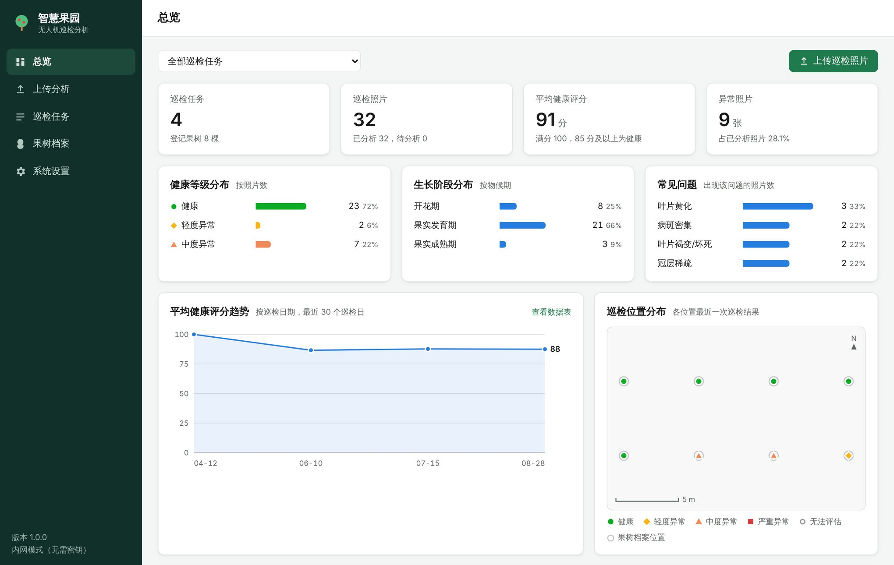
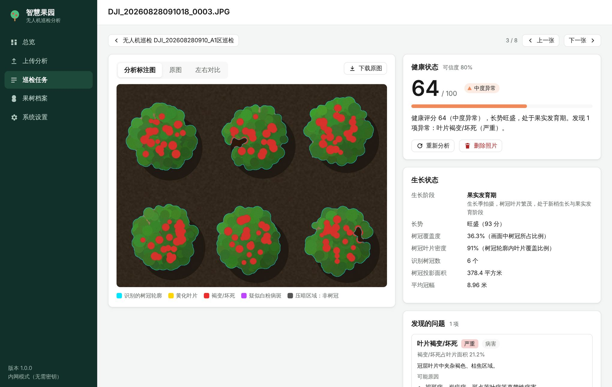
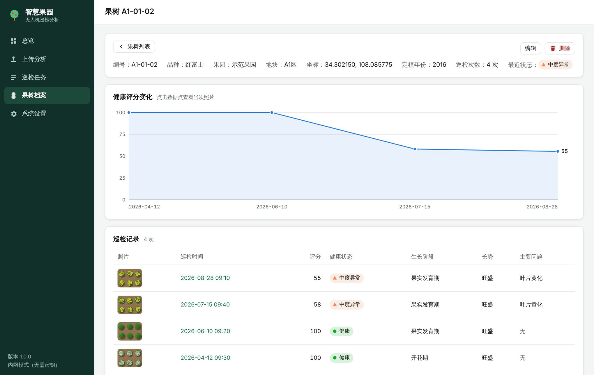

# 智慧果园巡检分析系统

对接巡检无人机拍摄的照片，自动分析果树的**生长状态**和**健康状态**。后端使用 Python（FastAPI），前端为无需构建的网页（由后端直接提供），一条命令即可启动。



| 单张照片分析结果 | 单株果树健康档案 |
| --- | --- |
|  |  |

> 截图中的照片是 `scripts/generate_demo_images.py` 合成的演示数据，不是真实果园照片。

## 功能

- **照片接入**：网页批量拖拽上传；无人机机场/地面站通过接口自动推送；照片目录监控脚本自动同步（断网重试、不重复上传）。
- **无人机元数据解析**：读取 EXIF 中的拍摄时间、GPS、海拔、相机与焦距，以及大疆 XMP 中的相对高度、云台俯仰/偏航角、RTK 状态；自动计算地面分辨率（GSD），倾斜拍摄时估算画面中心的地面坐标。
- **生长状态**：生长阶段（休眠、萌芽展叶、开花、果实发育、果实成熟、落叶）、长势等级与评分、树冠覆盖度、树冠叶片密度、树冠数量、树冠投影面积与平均冠幅。
- **健康状态**：0~100 健康评分与等级（健康/轻度/中度/严重异常），识别叶片黄化、褐变坏死、病斑密集、冠层稀疏、叶色偏淡、疑似白粉病斑等问题，给出可能原因和管理建议；同时检查照片是否过暗、过曝、模糊。
- **可视化**：分析标注图（树冠轮廓、黄化、褐变区域高亮），总览看板、健康趋势、拍摄位置分布图、任务内照片筛选。
- **果树档案**：登记或 CSV 导入每棵树的坐标，照片按 GPS 自动关联到最近的果树，形成单株历次巡检的健康曲线。
- **其他**：分析结果导出 CSV（Excel 可直接打开）；可接入自训练的 ONNX 病害识别模型；可选接口密钥；支持 Docker 部署。

## 快速开始

需要 Python 3.10 及以上。

```bash
git clone <仓库地址> && cd <仓库目录>
python -m venv .venv
source .venv/bin/activate        # Windows：.venv\Scripts\activate
pip install -r requirements.txt
python run.py
```

浏览器打开 <http://127.0.0.1:8000> 即可使用，接口文档在 <http://127.0.0.1:8000/docs>。

数据（SQLite 数据库、原图、缩略图、标注图）默认保存在项目根目录的 `data/` 下。

### 用演示数据体验

手头没有无人机照片时，可以先生成一套模拟数据（4 次巡检 × 8 棵果树，从 4 月花期到 8 月挂果，其中几棵树出现黄化、褐变、病斑、冠层稀疏）：

```bash
python scripts/generate_demo_images.py
```

然后在“果树档案”页面导入 `demo_images/trees.csv`，再模拟无人机自动推送照片：

```bash
python scripts/drone_uploader.py --server http://127.0.0.1:8000 --dir demo_images --orchard 示范果园 --once
```

稍等片刻，总览看板、任务、果树档案中就能看到分析结果。

## 对接巡检无人机

三种方式任选其一：

**1. 网页上传**：航线结束后，把存储卡或大疆司空 / DJI Pilot 2 导出的照片在“上传分析”页面批量上传。一次飞行对应一个巡检任务。

**2. 目录监控自动推送（推荐）**：在地面站电脑、机场边缘计算盒或照片同步服务器上运行 `scripts/drone_uploader.py`。它只依赖 Python 标准库（3.8+），可以单独拷贝过去使用：

```bash
python drone_uploader.py --server http://192.168.1.10:8000 --dir "D:/DJI/航线照片" --api-key 你的密钥 --orchard 示范果园 --plot A1区
```

- 每个子文件夹视为一次巡检任务，文件夹名即任务编号（也可用 `--mission` 指定）；
- 已上传的文件记录在目录下的 `.orchard_upload_state.json`，重启不会重复上传，网络中断会自动重试；
- 服务端需要用 `python run.py --host 0.0.0.0` 启动，局域网内的设备才能访问。

**3. 调用推送接口**：机场、飞控平台或自研系统直接调用：

```bash
curl -X POST http://服务器:8000/api/v1/drone/ingest \
  -H "X-API-Key: 你的密钥" \
  -F mission_code=20261125-A1 \
  -F orchard=示范果园 \
  -F files=@DJI_0001.JPG -F files=@DJI_0002.JPG

# 按任务编号查询分析结果
curl http://服务器:8000/api/v1/drone/missions/20261125-A1
```

任务不存在时自动创建；同一任务内重复推送同一张照片（按 SHA-256 判断）会被识别为重复，因此失败后可以放心重试。只需要分析结果、不需要保存时，可调用 `POST /api/v1/analyze`。

**拍摄建议**：云台垂直向下（-90°）、相对高度 10~30 米、光照均匀的时段（上午 9~11 点或下午 3~5 点）、保留照片原始 EXIF/XMP 信息。正射照片带有相对高度和 35mm 等效焦距时，才能估算树冠面积和冠幅；非大疆机型的照片缺少相对高度时，可在巡检任务中填写“飞行高度”。

## 分析方法

默认分析器基于可见光（RGB）图像的颜色与形态特征，**不需要训练数据**，结果可解释（每项结论都附有判定依据和标注图）。

1. **读取与缩放**：照片长边缩放到 1280 像素（JPEG 使用 DCT 降采样，2000 万像素照片也能快速处理）。
2. **植被指数与像素分类**：计算 ExG（超绿指数）、ExG-ExR、GLI（绿叶指数）、VARI、NGRDI 等可见光植被指数，按色相/饱和度/明度把像素划分为绿叶、黄叶、褐色、白/粉色（花）、红/橙色（果实）、阴影。
3. **树冠分割**：对叶片像素做形态学闭运算、填补树冠内部小空洞，把距离相近的叶丛碎片归为同一棵树，按面积和绿叶占比筛掉杂草碎片；每个树冠取凸包作为树冠投影轮廓。褐色像素只有处在叶丛中才计为“褐变”，避免把裸露土壤当成病斑。
4. **生长状态**：
   - 生长阶段：结合花朵占比、着色果实占比、黄叶占比和拍摄月份判断（南半球自动平移 6 个月）；
   - 长势评分：绿叶 GLI、树冠叶片密度、树冠绿度均匀性、症状占比加权；
   - 有 GSD 时换算树冠投影面积（平方米）和平均冠幅（米）。
5. **健康评分**：从 100 分起按下表扣分（区间内线性插值），单项“中等”问题使评分降到 85 以下，单项“严重”问题降到 70 以下：

   | 问题 | 判定指标 | 轻微 | 中等 | 严重 |
   | --- | --- | --- | --- | --- |
   | 叶片黄化 | 黄叶占叶片面积 | ≥5% | ≥12% | ≥25% |
   | 叶片褐变/坏死 | 褐变占叶片面积 | ≥2.5% | ≥6% | ≥15% |
   | 病斑密集 | 每万叶片像素零散病斑数 | ≥2 | ≥4 | ≥8 |
   | 冠层稀疏 | 树冠轮廓内叶片覆盖率 | <60% | <50% | <35% |
   | 叶色偏淡 | 绿叶 GLI 均值 | <0.20 | <0.15 | <0.10 |
   | 疑似白粉病斑 | 非花期树冠内白色斑块占比 | ≥5% | ≥12% | ≥25% |

   健康等级：≥85 健康，70~85 轻度异常，50~70 中度异常，<50 严重异常。秋季自然转黄会降低黄化扣分权重；休眠期、落叶期不评估叶片健康，只给出季节性管理建议。
6. **图像质量**：亮度、对比度、清晰度（归一化拉普拉斯方差）不合格时给出提示并降低结果可信度。

**适用范围与局限**（请务必了解）：

- 规则方法适合发现“颜色/形态异常”，**不能确诊具体病害种类**，结论用于辅助巡检，确诊需现场核查或取样检测；
- 行间生草的果园里，草地与树冠颜色相近，可能被一并计入树冠；红壤等高饱和度土壤可能被误计为褐变；
- 黄色品种的成熟果实（如梨、柠檬）与黄化叶片颜色接近；
- 阈值来自常见可见光植被指数文献和经验，并用合成场景做了校验，**建议用本地真实照片抽样复核后再调整**：阈值在 `backend/app/analysis/color.py`（`ColorThresholds`）和 `backend/app/analysis/engine.py`（`AnalyzerConfig`、`PENALTY_TABLES`），中文文案与建议在 `backend/app/analysis/knowledge.py`；
- 暂不支持多光谱单波段影像（如 NDVI 所需的近红外波段）。

## 接入自训练模型

积累了带标注的巡检照片后，可以训练分类模型（ResNet、EfficientNet、YOLO-cls 等）识别具体病害，导出为 ONNX 后接入：

```bash
pip install onnxruntime
export ORCHARD_MODEL_PATH=/path/to/model.onnx
export ORCHARD_MODEL_LABELS=/path/to/labels.json
python run.py
```

`labels.json` 示例：

```json
{
  "input_size": [224, 224],
  "mean": [0.485, 0.456, 0.406],
  "std": [0.229, 0.224, 0.225],
  "labels": [
    {"name": "healthy", "label": "健康", "healthy": true},
    {"name": "scab", "label": "苹果黑星病", "severity": "high", "suggestions": ["清除病叶病果", "喷施苯醚甲环唑等杀菌剂"]}
  ]
}
```

模型输出 `[1, 类别数]` 的 logits 或概率。识别为非健康类别且置信度达到 `ORCHARD_MODEL_MIN_CONFIDENCE` 时，结果作为一条“模型识别”问题加入健康评估并参与扣分；模型加载失败时自动退回规则分析。详见 `backend/app/analysis/model_adapter.py`。

## 配置

通过环境变量或项目根目录的 `.env` 文件配置（参考 `.env.example`）：

| 变量 | 默认值 | 说明 |
| --- | --- | --- |
| `ORCHARD_API_KEY` | 空 | 设置后，上传、修改、删除等写操作需在请求头携带 `X-API-Key`；网页在“系统设置”中填写 |
| `ORCHARD_DATA_DIR` | `./data` | 数据库与图片存放目录 |
| `ORCHARD_DATABASE_URL` | data 目录下的 SQLite | 可改为 PostgreSQL 等（需安装对应驱动） |
| `ORCHARD_WORKERS` | `2` | 后台分析线程数 |
| `ORCHARD_ANALYSIS_MAX_SIDE` | `1280` | 分析分辨率（长边像素） |
| `ORCHARD_MAX_UPLOAD_MB` | `60` | 单张照片大小上限 |
| `ORCHARD_TREE_MATCH_RADIUS_M` | `3` | 照片与果树自动关联的距离（米） |
| `ORCHARD_MODEL_PATH` / `ORCHARD_MODEL_LABELS` | 空 | 可选的 ONNX 模型及标签文件 |
| `ORCHARD_MODEL_MIN_CONFIDENCE` | `0.5` | 模型结果计入健康评估的最低置信度 |
| `ORCHARD_CORS_ORIGINS` | 空 | 前端单独部署时允许跨域的地址，逗号分隔 |

## 接口一览

完整说明见 `/docs`（自动生成的交互式文档）。

| 方法 | 路径 | 说明 |
| --- | --- | --- |
| `GET` / `POST` | `/api/v1/tasks` | 巡检任务列表 / 创建任务 |
| `GET` / `PATCH` / `DELETE` | `/api/v1/tasks/{id}` | 任务详情 / 修改 / 删除（含照片） |
| `POST` | `/api/v1/tasks/{id}/images` | 上传照片（multipart，字段 `files`，可多张） |
| `POST` | `/api/v1/tasks/{id}/reanalyze` | 重新分析任务内全部照片 |
| `GET` | `/api/v1/tasks/{id}/export.csv` | 导出分析结果 |
| `GET` | `/api/v1/images` | 照片列表，可按任务、果树、健康等级、状态筛选 |
| `GET` | `/api/v1/images/{id}` | 照片详情与完整分析结果 |
| `GET` | `/api/v1/images/{id}/file`、`/thumbnail`、`/overlay` | 原图 / 缩略图 / 分析标注图 |
| `POST` / `DELETE` | `/api/v1/images/{id}/reanalyze`、`/api/v1/images/{id}` | 重新分析 / 删除照片 |
| `POST` | `/api/v1/drone/ingest` | 无人机推送照片（按 `mission_code` 归档） |
| `GET` | `/api/v1/drone/missions/{mission_code}` | 按任务编号查询分析结果 |
| `GET` / `POST` | `/api/v1/trees` | 果树列表 / 登记果树 |
| `POST` | `/api/v1/trees/import` | CSV 批量导入果树（UTF-8 或 GBK） |
| `GET` / `PATCH` / `DELETE` | `/api/v1/trees/{id}` | 果树详情（含历次巡检）/ 修改 / 删除 |
| `GET` | `/api/v1/stats/overview`、`/api/v1/stats/map` | 总览统计、位置分布 |
| `POST` | `/api/v1/analyze` | 即时分析单张照片（不保存） |

分析结果（`GET /api/v1/images/{id}` 的 `result` 字段）结构示例：

```json
{
  "summary": "健康评分 64（中度异常），长势旺盛，处于果实发育期。发现 1 项异常：叶片褐变/坏死（严重）。",
  "growth": {
    "stage": "fruit_development", "stage_label": "果实发育期",
    "vigor_level": "strong", "vigor_label": "旺盛", "vigor_score": 93.0,
    "canopy_coverage": 0.363, "foliage_density": 0.91, "crown_count": 6,
    "canopy_area_m2": 378.4, "mean_crown_diameter_m": 8.96
  },
  "health": {
    "score": 63.7, "level": "moderate", "level_label": "中度异常", "confidence": 0.8,
    "issues": [{
      "code": "necrosis", "name": "叶片褐变/坏死", "severity": "high", "severity_label": "严重",
      "evidence": "褐变/坏死占叶片面积 21.2%",
      "possible_causes": ["褐斑病、炭疽病、斑点落叶病等真菌性病害", "..."],
      "suggestions": ["现场核查病斑形态，必要时取样送检确诊", "..."]
    }],
    "suggestions": ["现场核查病斑形态，必要时取样送检确诊", "..."]
  },
  "indices": {"exg": 0.63, "gli": 0.41, "vari": 0.44, "chlorosis_ratio": 0.0, "necrosis_ratio": 0.212},
  "quality": {"brightness": 0.41, "contrast": 0.08, "sharpness": 778.0, "ok": true, "issues": []}
}
```

## 项目结构

```
├── run.py                      # 一键启动
├── backend/
│   ├── app/
│   │   ├── main.py             # FastAPI 应用入口
│   │   ├── config.py           # 配置（环境变量 / .env）
│   │   ├── models.py           # 数据表：巡检任务、照片、果树
│   │   ├── schemas.py          # 接口数据结构
│   │   ├── api/                # 接口：tasks、images、drone、trees、system
│   │   ├── analysis/           # 图像分析：植被指数、树冠分割、生长/健康评估、ONNX 模型接入、农学知识库
│   │   ├── drone/              # 无人机元数据（EXIF、大疆 XMP）、GSD、地理计算
│   │   ├── services/           # 入库、后台分析队列、果树匹配、统计、文件存储
│   │   └── demo_data.py        # 演示照片生成
│   └── tests/                  # 自动化测试
├── frontend/                   # 网页（原生 JS，无需构建，由后端直接提供）
│   ├── index.html
│   ├── css/style.css
│   └── js/                     # 路由、接口封装、SVG 图表、各页面
├── scripts/
│   ├── drone_uploader.py       # 照片目录监控上传工具（仅依赖标准库）
│   └── generate_demo_images.py # 生成演示数据
├── Dockerfile / docker-compose.yml
└── requirements.txt / requirements-dev.txt
```

## 开发与测试

```bash
pip install -r requirements-dev.txt
pytest            # 运行全部测试（分析算法、元数据解析、接口、无人机推送、目录上传脚本、ONNX 模型接入）
ruff check backend scripts
python run.py --reload   # 开发模式，代码修改后自动重启
```

## 部署

**Docker**：

```bash
ORCHARD_API_KEY=请改成随机长字符串 docker compose up -d --build
```

数据保存在宿主机的 `./data` 目录。

**生产环境建议**：

- 设置 `ORCHARD_API_KEY`；系统没有用户登录功能，查询接口不需要密钥，请部署在内网，或放在带登录认证的反向代理（如 Nginx）之后；
- 反向代理需调大上传大小限制（如 Nginx `client_max_body_size 200m;`）；
- 定期备份 `data/` 目录（数据库与照片）；照片量很大或多人同时使用时，可改用 PostgreSQL；
- 分析是 CPU 密集型任务，`ORCHARD_WORKERS` 建议不超过 CPU 核数。

## 后续可扩展方向

- 接入多光谱相机（如 Mavic 3M）的近红外波段，计算 NDVI、NDRE 等更可靠的长势指标；
- 用 YOLO 等检测模型逐棵定位树冠与病斑，替代颜色规则分割；
- 地图底图展示（注意国内地图服务使用 GCJ-02 坐标，需要从 WGS-84 转换）；
- 病虫害预警推送（短信、企业微信、钉钉）。
